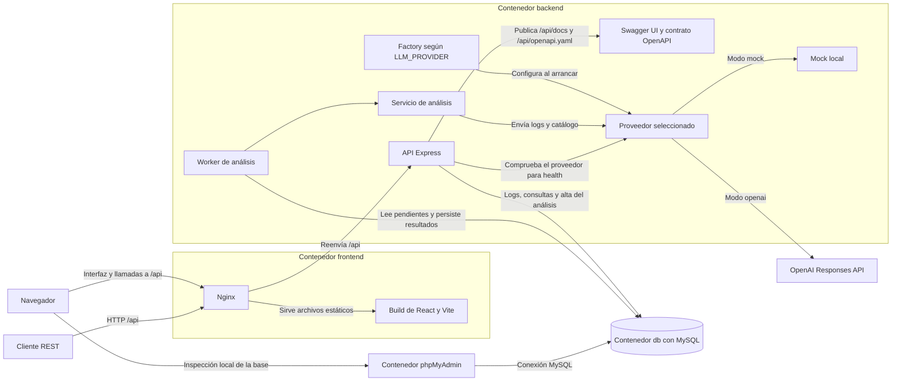

# Arquitectura de SmartLog Analyzer

Este diseño describe un prototipo para investigar incidentes en logs de varios microservicios. La demo parte del conteo por servicio y nivel, sigue una traza entre servicios, ejecuta un análisis y consulta los hallazgos con sus logs de respaldo.

## Componentes y flujo de datos

El monorepo organiza la interfaz en `frontend/` y la API y el worker en `backend/`. Un `docker-compose.yml` en la raíz levanta cuatro servicios con `docker compose up`.

- `frontend` compila React con Vite y sirve los archivos con Nginx. Publica el puerto de la demo, por ejemplo `localhost:8080`, y reenvía `/api/*` al servicio `backend` conservando el prefijo. La interfaz y la API están disponibles desde el mismo origen.
- `backend` ejecuta Express, Sequelize y el worker. Compose espera a que pase el healthcheck de MySQL en el arranque inicial. El backend reintenta la conexión durante el arranque si MySQL aún no está listo, como puede suceder al reiniciar ambos servicios. Luego aplica las migraciones y los seeds pendientes y marca los análisis interrumpidos antes de aceptar solicitudes.
- `db` ejecuta MySQL con InnoDB. Express y phpMyAdmin se conectan a MySQL por la red interna de Compose.
- `phpmyadmin` permite inspeccionar el esquema y los datos de MySQL desde un puerto local independiente, `127.0.0.1:8081` por defecto. Compose lo inicia cuando MySQL pasa el healthcheck.

La interfaz usa la API para mostrar el resumen, filtrar y paginar logs, iniciar análisis por filtros o IDs y consultar hallazgos con su evidencia. Obtiene el catálogo en `GET /api/categories` para mostrar las descripciones y usar los códigos en el filtro de hallazgos. Se propone TanStack Query para las consultas y el polling de cada análisis, que se detiene en `COMPLETED` o `FAILED`.

MySQL conserva sus datos en un volumen. El catálogo y los logs de ejemplo se cargan automáticamente mediante seeds con historial persistido. El catálogo usa códigos estables y la carga de logs se confirma en la misma transacción que su registro en el historial. El README documenta puertos, red, variables de entorno y los pasos de la demo, incluido el intervalo fijo de los logs de ejemplo.

### Ciclo del análisis

1. `POST /api/logs/analyze` acepta filtros o una lista explícita de IDs. Resuelve la selección en ese momento y valida que tenga entradas, que los IDs solicitados existan y que el conjunto completo esté dentro de los límites. Los topes predeterminados son **100 logs y 32 KiB de logs serializados** y se ajustan con `ANALYSIS_MAX_LOGS` y `ANALYSIS_MAX_KIB`. Si la selección supera un tope, la respuesta indica cómo acotarla.
2. La API guarda el análisis en `PENDING` y su selección exacta en `analysis_logs`, en una sola transacción. Devuelve `202 Accepted` con el ID después del commit. Si falta la configuración local requerida de OpenAI, devuelve `503` antes de crear el registro.
3. Un worker dentro de la aplicación consulta los pendientes de MySQL y procesa uno a la vez. El prototipo se ejecuta como una sola instancia. El worker lee los logs de la selección guardada y el catálogo, y llama al proveedor con un tiempo límite. La llamada se realiza fuera de la transacción de base de datos.
4. El servicio valida el resumen, los hallazgos y las referencias antes de guardar el resultado. Las categorías deben pertenecer al catálogo y cada log citado debe pertenecer a la selección de ese análisis. El informe, los hallazgos, sus vínculos y el cambio a `COMPLETED` se escriben en una sola transacción. Un timeout, una respuesta inválida o un error del proveedor dejan el análisis en `FAILED` con un motivo consultable.
5. `GET /api/analysis/{id}` devuelve el estado y los IDs seleccionados. `PENDING` abarca la espera y la ejecución. Al arrancar tras un reinicio, los registros que quedaron en ese estado pasan a `FAILED` por interrupción. Un nuevo `POST` permite reintentar y genera otro ID. Para repetir exactamente la selección anterior se usan los IDs registrados.

### Proveedor y disponibilidad

La Factory resuelve `LLM_PROVIDER` al iniciar. `mock` es el valor predeterminado y produce resultados reproducibles que dependen de los logs recibidos. `openai` usa `OPENAI_API_KEY` y `OPENAI_MODEL` para invocar la Responses API con Structured Outputs. Ambos proveedores pasan por la validación del servicio. `.env.example` documentará la configuración con valores de ejemplo y la clave vacía. [OpenAI Docs sobre Structured Outputs](https://developers.openai.com/api/docs/guides/structured-outputs)

`GET /api/health` informa el estado de MySQL y del proveedor. El mock reporta `ok`. Para OpenAI, la aplicación revisa la configuración local y, cuando está completa, hace una comprobación autenticada sin enviar logs, con un timeout corto y un resultado reutilizable durante un intervalo breve. Puede informar configuración ausente, credenciales rechazadas, problemas de conexión o errores del proveedor.

| MySQL | Proveedor | Respuesta general |
| --- | --- | --- |
| Disponible | Disponible | `200`, `ok` |
| Disponible | Con problemas | `200`, `degraded`. La ingesta y las consultas siguen disponibles. |
| No disponible | Cualquier estado | `503`, `unavailable` |

La API acepta selecciones válidas durante un fallo transitorio reportado por health. El estado final del análisis depende del intento real.

## Modelo de datos

| Tabla | Contenido y relaciones |
| --- | --- |
| `logs` | ID, fecha del evento, servicio, nivel, mensaje y `trace_id` opcional. |
| `analyses` | ID, estado, fechas de creación y finalización, resumen o código y motivo de fallo. |
| `analysis_logs` | Relación entre análisis y logs con clave compuesta `(analysis_id, log_id)`. La clave foránea impide borrar un log mientras esté referenciado. |
| `categories` | Código estable y descripción. El seed carga el catálogo inicial. Agregar registros permite ampliarlo. |
| `findings` | ID, análisis, categoría, fecha de creación, descripción del problema y sugerencia de acción. Un análisis puede tener cero o más hallazgos. |
| `finding_logs` | Relación entre cada hallazgo y los logs que lo respaldan. El servicio verifica su pertenencia a `analysis_logs`. |

Los filtros de fecha se aplican al instante del evento. Se propone aceptar fechas ISO 8601 con zona horaria y usar un rango con inicio inclusivo y fin exclusivo para evitar solapamientos entre intervalos consecutivos.

## Contrato REST y OpenAPI

El contrato se define desde el primer incremento en `backend/openapi.yaml`. Express publica el archivo en `GET /api/openapi.yaml` y sirve Swagger UI en `/api/docs`. El documento usa `/api` como base relativa y declara rutas como `/logs`, `/analysis/findings` y `/categories`. Así, **Try it out** usa el origen de la demo también cuando se accede por Nginx.

Los ejemplos del contrato siguen el recorrido del seed e incluyen selección por filtros o IDs, aceptación en `PENDING`, selección fuera de límites y health degradado. Cada cambio de endpoint se acompaña de su actualización en OpenAPI y de la prueba de integración correspondiente.

| Método y ruta | Comportamiento |
| --- | --- |
| `POST /api/logs` | Valida y guarda un log. Devuelve `201` y su ID. |
| `GET /api/logs` | Lista logs por servicio, nivel, rango de fechas o `traceId`, con paginación. |
| `GET /api/logs/summary` | Aplica los mismos filtros de logs y devuelve el conteo por servicio y nivel. Es el punto de entrada de la demo. |
| `POST /api/logs/analyze` | Valida filtros o IDs y devuelve `202` con el ID del análisis aceptado. |
| `GET /api/analysis/{id}` | Devuelve el estado, los IDs seleccionados y, cuando corresponde, el informe completo o el motivo del fallo. |
| `GET /api/analysis/findings` | Lista hallazgos por categoría, servicio o fecha de los logs de evidencia, con paginación. |
| `GET /api/categories` | Devuelve el catálogo completo de categorías con sus códigos y descripciones, sin paginación. |
| `GET /api/health` | Informa el estado de la base y del proveedor de análisis. |

En `GET /api/analysis/findings`, si se combinan servicio y fechas, un mismo log de evidencia debe cumplir ambos filtros. Cada hallazgo aparece una sola vez aunque coincidan varios logs. Los listados de logs y hallazgos usan `limit` de 1 a 100 (por defecto 50), `offset` entero desde 0 (por defecto 0) y `hasMore` calculado a partir de una fila adicional. El orden propuesto es descendente por fecha del evento para logs y por fecha de creación para hallazgos, con ID descendente como desempate. El tamaño de la página es independiente del límite de un análisis.

Las respuestas de error de la API usan `error.code` y `error.message`. Devuelven `400` para parámetros inválidos o modos de selección combinados, `404` para un análisis o una ruta inexistentes, `413` para un cuerpo HTTP que supera el límite de tamaño, `422` para una selección vacía, demasiado grande o con IDs inexistentes y `503` para dependencias indispensables que estén indisponibles. La respuesta `503` de health incluye también el estado y el resultado de cada comprobación.

## Decisiones y alternativas

| Decisión | Alternativa considerada y motivo |
| --- | --- |
| JavaScript y Express | NestJS aporta más convenciones y FastAPI ofrece documentación interactiva y validación integrada. Express cubre el tamaño de esta API y permite reutilizar middleware de validación y errores. |
| React con Vite | Next.js aporta rutas y renderizado en servidor. La interfaz consume Express desde el navegador y Vite permite compilarla como archivos estáticos. |
| Nginx en un servicio separado | Servir el build desde Express también permite arrancar con un solo comando. Nginx sirve la interfaz por separado y mantiene un único origen para la demo y la API. |
| OpenAPI desde el primer incremento | Generar documentación a partir de las rutas fue una alternativa. El contrato versionado permite acordar esquemas y ejemplos antes de implementar cada operación y usarlos también desde Swagger UI. |
| MySQL con InnoDB y Sequelize | PostgreSQL cubre el mismo modelo relacional. MongoDB facilita documentos con estructura variable. La experiencia con MySQL y Sequelize pesa más para implementar y probar las migraciones, la agregación y las relaciones. SQL directo también era viable. Sequelize permite reutilizar filtros y usar SQL parametrizado cuando aporta claridad. |
| Worker local que consulta MySQL | Una cola en memoria introduce un paso entre guardar y encolar. Un broker dedicado agrega un servicio a Compose. Usar `PENDING` como registro de trabajo permite que el worker lea directamente lo que la API ya confirmó. |
| Interrupción visible y reintento manual | Retomar automáticamente exigiría definir cuándo repetir una llamada que pudo haberse ejecutado antes del reinicio. El estado `FAILED` conserva el intento original y permite iniciar uno nuevo de forma explícita. |
| Mock y OpenAI configurables | Usar solo OpenAI requeriría credenciales para la demo. Usar solo el mock limitaría la demostración de la integración real. La Factory permite probar ambos modos con el mismo contrato. |
| Referencias a logs originales | Copiar los logs duplicaría los datos del prototipo. Si se incorpora una política de limpieza, guardar una copia de los campos enviados al proveedor preservaría la evidencia después de eliminar los originales. |
| Catálogo y hallazgos en tablas | Las categorías libres dificultan comparar informes. Guardar todos los hallazgos en un JSON facilita recuperar un informe completo. Las tablas permiten consultar hallazgos entre análisis y vincular cada sugerencia con su categoría y evidencia. La API expone el catálogo en modo de solo lectura. |
| Selección completa y acotada | Analizar una muestra o los logs más recientes podría omitir el evento que inició un incidente. La API rechaza el conjunto completo si supera el tope de cantidad o de tamaño. |
| Agregación por API y seed automático | Un script SQL aislado demostraría la agregación. El endpoint y la carga automática permiten usarla para elegir qué investigar desde el primer arranque. |
| Paginación con `limit` y `offset` | Un cursor sería útil para listados profundos o con muchas inserciones. La paginación por desplazamiento cubre la demo y acota la respuesta. Se revisarán los filtros principales con `EXPLAIN`, ya que un `offset` alto sigue teniendo costo. |
| Mocha y Chai para el backend, Vitest para el frontend | Vitest en todo el monorepo permitiría mantener un solo runner. Se eligió Mocha y Chai para Express, y Vitest para aprovechar la configuración de Vite al probar React. |
| MySQL de pruebas con Testcontainers | Una base de pruebas en Compose también es viable. Testcontainers deja el arranque y la eliminación de la base a cargo de la suite. |

## Verificación prevista

- **Backend unitario con Mocha y Chai.** Probar filtros, paginación, límites, selección por IDs y validación de categorías y evidencias.
- **Integración HTTP y persistencia con Mocha, Chai, Supertest y Testcontainers.** Supertest ejecuta solicitudes contra la aplicación Express. La suite levanta un MySQL temporal con la misma imagen que usa Compose, aplica las migraciones y carga datos de prueba. Cubre ingesta, agregación, consulta de hallazgos y persistencia del análisis. Verifica que un hallazgo aparezca una sola vez cuando coinciden varios logs de evidencia y que el `202` se devuelva después de guardar la selección.
- **Flujo asíncrono con proveedor simulado.** Una respuesta válida deja el informe en `COMPLETED`. Un formato inesperado y un timeout dejan el análisis en `FAILED` con un motivo consultable. Comprobar también que tras un reinicio el intento previo quede registrado como interrumpido y se pueda reenviar.
- **Frontend con Vitest, React Testing Library y jsdom.** Probar la selección por filtros o filas, el estado pendiente, el fin del polling cuando el análisis termina y la consulta de hallazgos con su evidencia.
- Verificar `docker compose up` sobre un volumen nuevo y tras reiniciar. Revisar que la demo funcione con el mock y que la falta de configuración de OpenAI degrade health y rechace el análisis según lo acordado.
- Desde el puerto publicado por Nginx, recorrer la interfaz y confirmar que Swagger UI carga el contrato y permite ejecutar una consulta de ejemplo contra `/api`.

El README indicará los comandos para ejecutar las suites. Las pruebas de integración con Testcontainers requieren Docker activo.
